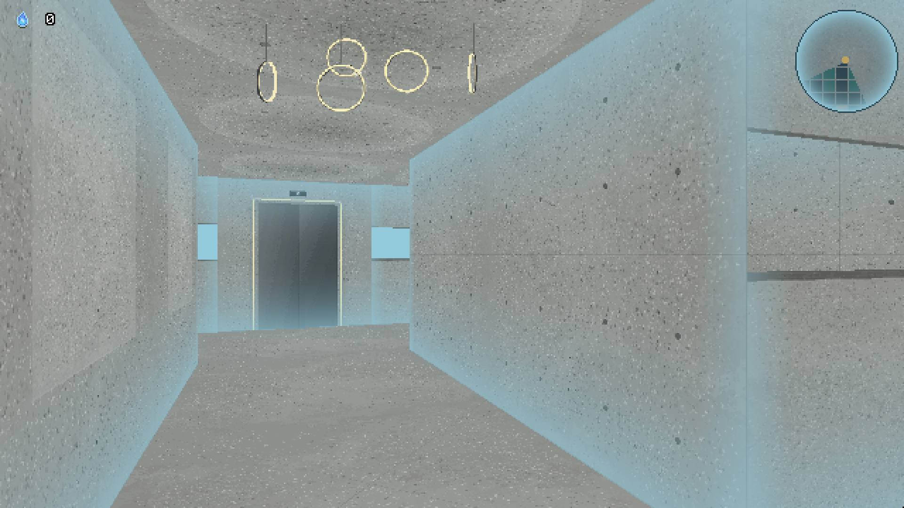
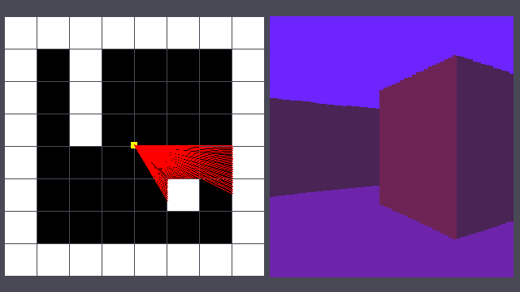
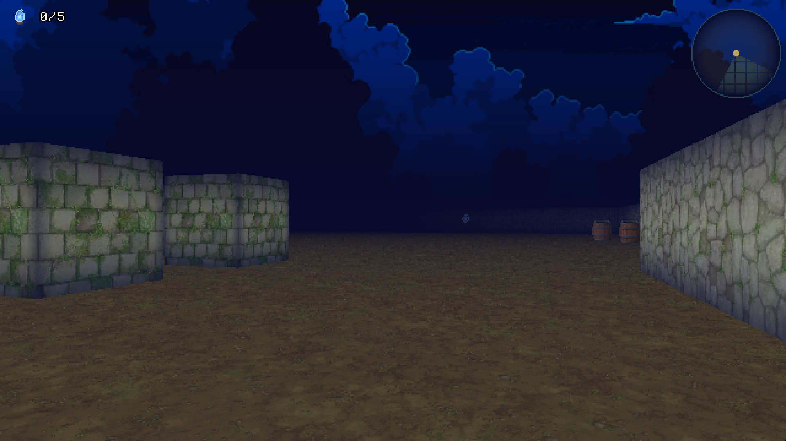
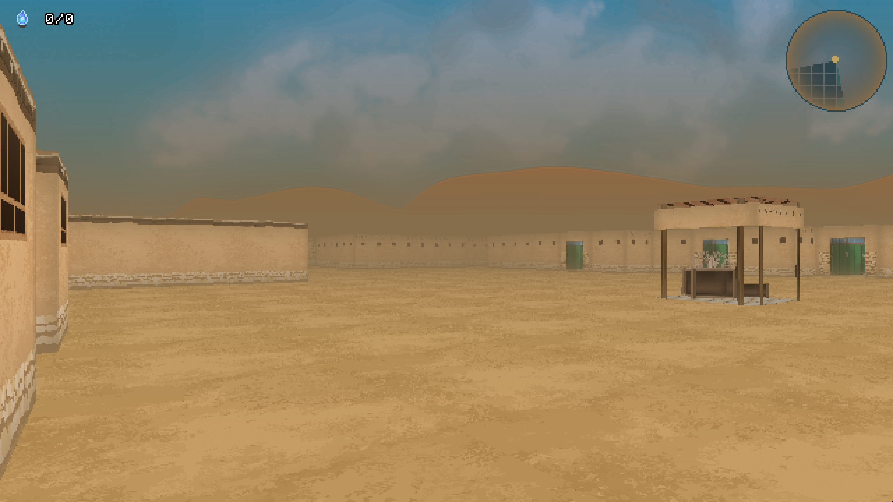
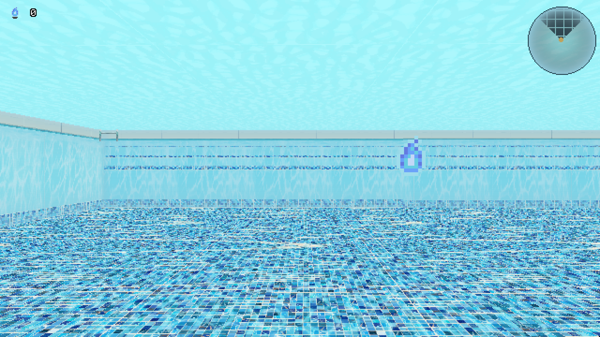
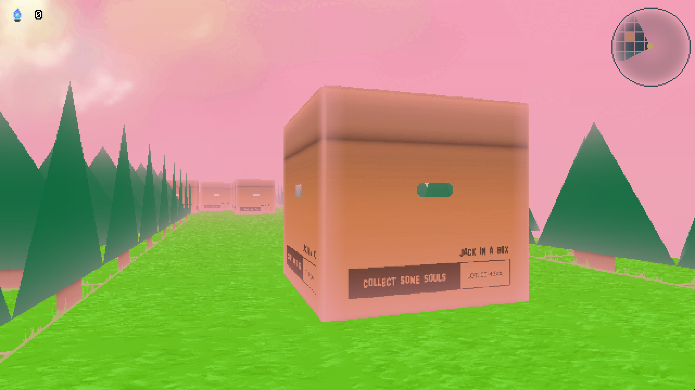
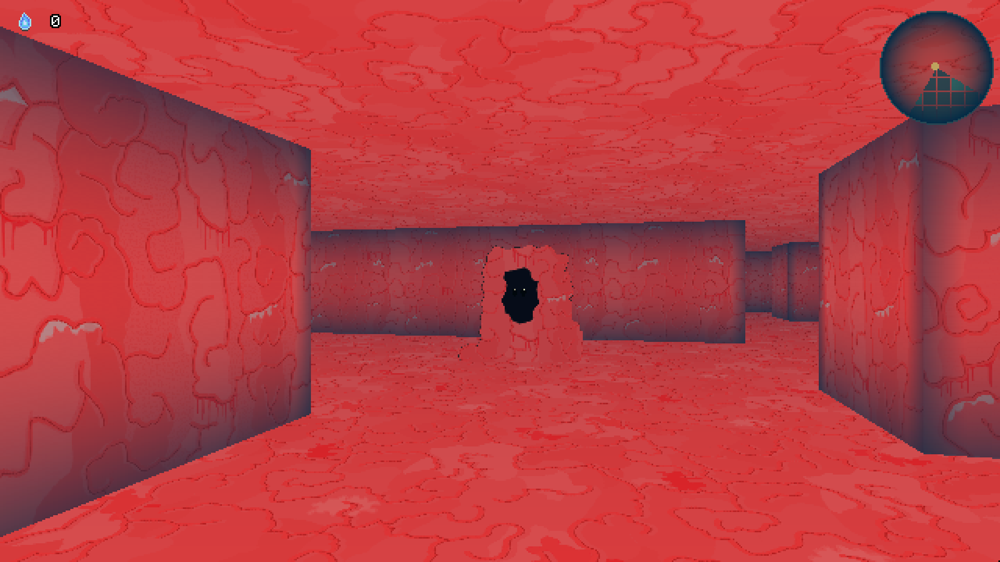
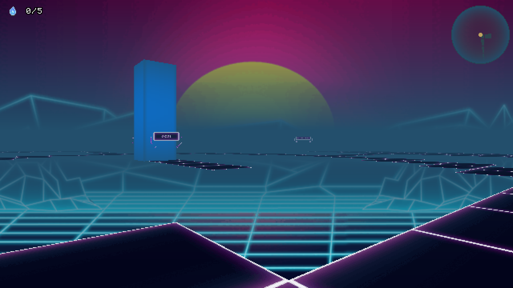
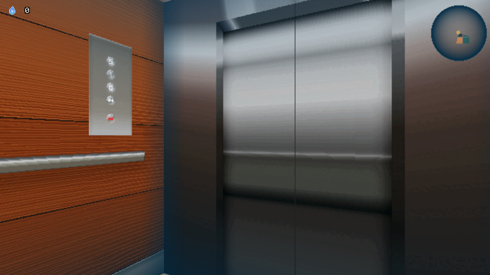
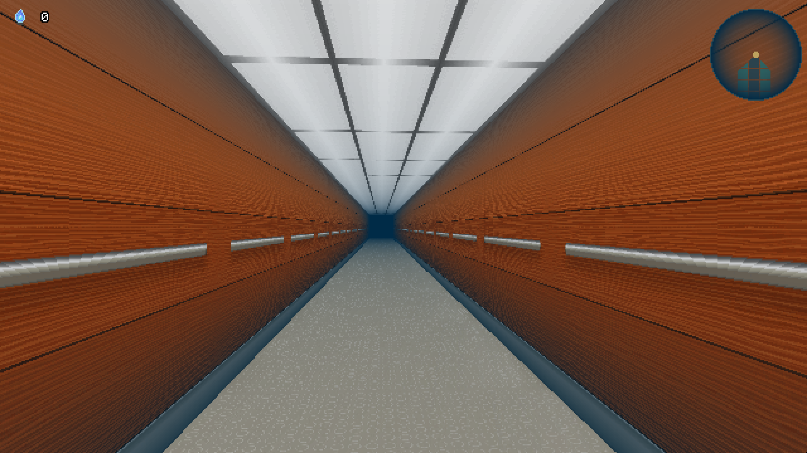

# Olafur

[Link to the video (YouTube)](https://www.youtube.com/watch?v=x2WowL4_kiA)  
[Link to the download page (Itch.io)](https://lycorisbellua.itch.io/olafur)  

## Explanation

**Olafur** is written in C, with [GLFW](https://www.glfw.org) (version 3.4.0) 
for the windowing, [OpenGL](https://docs.gl) (version 4.0+ required) for 
graphics, [LodePNG](https://github.com/lvandeve/lodepng) to process PNG images, 
and [dr_mp3](https://github.com/mackron/dr_libs) and 
[OpenAL](https://github.com/kcat/openal-soft) (version 1.24.3) for audio.  

It's a grid-based pseudo 3D game running solely on the CPU. It means that a 2D 
map is translated into 3D using a technique called raycasting. Rays are casted 
from the camera until walls are hit, which tells us how far away they are. 
Knowing the distance allows us to draw the walls: far makes them small, and 
close makes them big. An example of such a game is Wolfenstein 3D.  

## Levels

Give a specific `*.map` file as argument to the program, or don't give any to 
default to the first map of the `assets/maps/` folder.  

- `assets/maps/test/*`:  
The Test level is where I develop features.  

- `assets/maps/olafur/*` (recommended entry `_mus.map`):  
The Olafur level is a museum where each painting leads to another mini-world. 
It has been designed by Hellchauffo 
([Figma](https://www.figma.com/proto/UshKwYvv5vY0WgejO4WXR2/Workflow?node-id=82-974) 
and [GitHub](https://github.com/Lucie-Kin)), a friend of mine. She is behind 
the concept, the map layouts, the sprites, the textures and the choice of music 
tracks. This has been quite the undertaking and I thank her for this work. This 
level was designed in the context of a school project we worked on together, a 
grid-based pseudo 3D game as well, and she allowed me to keep the level for my 
personal project. This comes in quite handy, as I now have a level to showcase 
what the game is capable of. As for my contribution to the level, I've picked 
the elevator music, the sound effects, and added an easter egg accessible from 
the elevator (and through your keyboard).  

## Controls

| Action                             | Control                                                       |
| ---------------------------------- | ------------------------------------------------------------- |
| Movement and rotation              | WASD, arrow keys, keypad with Num Lock off, or Page Up & Down |
| Rotate with the mouse              | Hold the right button and drag left or right                  |
| Strafe                             | Q & E                                                         |
| Speed                              | Hold Shift to run, release to walk                            |
| Zoom minimap in/out                | Mouse scroll wheel                                            |
| Quit                               | Click the window X button, Alt+F4, or Escape                  |
| Reset player position and rotation | F5                                                            |
| Toggle VSync (on by default)       | F10                                                           |
| Toggle fullscreen                  | F11                                                           |
| Toggle VSync status + FPS counter  | F12                                                           |

## More Screenshots

